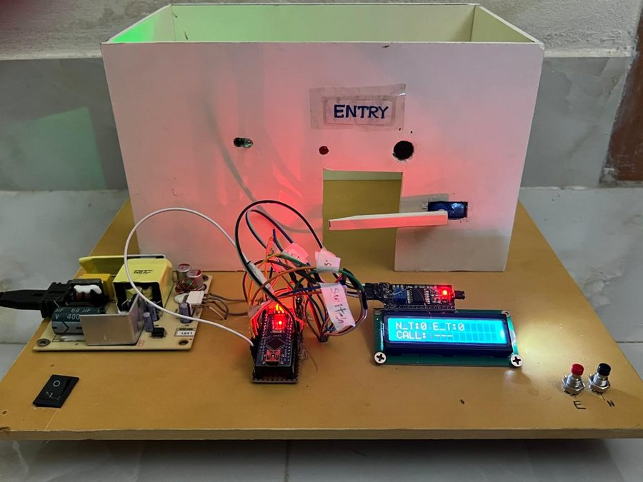

I'm a third-year Computer Science & Engineering student at United International University in Dhaka, and I've worked as a graphic designer for more than five years. The two feed each other: I sketch an interface before I write it, and I like automating the repetitive parts of both jobs.

On the design side, most of my work is brand identities, vector illustration, mascot art and posters. Over 10,500 of those assets are live on Adobe Stock and Freepik. On the engineering side I mostly write Python, Java and C++, and I'm comfortable with React, Node.js and MySQL when a project needs a web front end and a database.

## Featured

<table>
  <tr>
    <td width="46%"></td>
    <td valign="top">
      <h3>Smart Queue Management System</h3>
      
An Arduino Nano queue system built for the Electronics Lab course and <strong>selected for the intra-university project show</strong>. A customer presses a button for a numbered token, staff call the next one, and every call is announced by a buzzer, an LED, a moving servo arm and an LCD that shows who is being served and how many are waiting.

      
Arduino Nano · C++ · I2C LCD · servo · SMPS

      
<a href="https://github.com/splashahnaf445/Smart-Queue-Management-System">Source and write-up</a> · <a href="https://github.com/splashahnaf445/Smart-Queue-Management-System/blob/main/docs/SQMS-Project-Report.pdf">Project report (PDF)</a>

    </td>
  </tr>
</table>

## Selected projects

| Project | What it is | Stack |
|---|---|---|
| [**Seekr**](https://github.com/splashahnaf445/Seekr) | Lost-and-found portal for university campuses: report an item, search the feed, message, claim, with an admin dashboard | React, Node.js, MySQL |
| [**LawAid**](https://github.com/splashahnaf445/LawAid) | AI-assisted legal consultation platform for Bangladesh. Full SRS, UML set and a 13-screen Figma prototype from a team project (design phase complete) | Figma, UML, SRS |
| [**Tuition Fee Calculator**](https://github.com/splashahnaf445/Tutionfee-calculator) | Works out fees from credit matrices and waiver rules | Java Swing |
| [**Computer Networks**](https://github.com/splashahnaf445/Computer-Networks) | Lab work in Cisco Packet Tracer: a 6-router enterprise network running RIP v2 and OSPF, VLSM and DHCP, an ACL exercise | Cisco IOS |

Coursework: [JavaFX](https://github.com/splashahnaf445/JavaFX) (OOP and GUI programming in Java) and [Data Structures](https://github.com/splashahnaf445/Data-Structures-LL-stack-Q-Search-Graph) (linked lists, stacks, queues, sorting, searching, BST, graphs in C++).

## Tools

| | |
|---|---|
| **Languages** | Python, Java, C++, JavaScript |
| **Web and data** | React, Node.js, MySQL |
| **Networking** | Cisco Packet Tracer: static routing, RIP, OSPF, DHCP, ACLs |
| **Hardware** | Arduino |
| **Design** | Illustrator, Photoshop, Figma, Canva |

## Elsewhere

- **Design portfolio:** [Behance](https://www.behance.net/shahriarahnaf)
- **Stock work:** [Adobe Stock](https://stock.adobe.com/contributor/212238217/stockimgahnaf) · [Freepik (Magnific)](https://www.magnific.com/author/shahriarahnaf)
- **Professional:** [LinkedIn](https://www.linkedin.com/in/ahnaf-shahriar15/)
- **Video:** [YouTube](https://www.youtube.com/@itsahnaf666)
- **Email:** [shahriarahnaf420@gmail.com](mailto:shahriarahnaf420@gmail.com)
